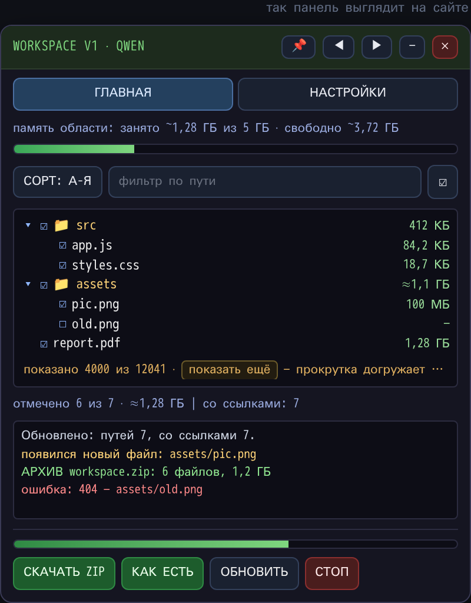

# WORKSPACE V1 — QWEN и Z.AI

**Спасение рабочей области чатов [chat.qwen.ai](https://chat.qwen.ai) и [chat.z.ai](https://chat.z.ai)** — боковая панель с деревом файлов и размерами; выгрузка всей области одним ZIP со структурой папок, прогресс и отмена.

| Что | Где |
|---|---|
| Открыть HTML-панель прямо на странице | [Workspace_Tools_V1.html](https://flash72i.github.io/WORKSPACE-V1_QWEN-Z.AI/Workspace_Tools_V1.html) |
| Скачать расширение (zip) и HTML-панель файлом | [Releases](https://github.com/flash72i/WORKSPACE-V1_QWEN-Z.AI/releases) — в описании релиза краткая инструкция по установке |
| Файлы проекта | `Workspace_Tools_V1.html` — страница-панель · `Workspace Rescue V1.zip` — расширение Chrome (MV3), сборка 1.1.9 |

## Установка расширения

1. Скачайте `Workspace Rescue V1.zip` из [Releases](https://github.com/flash72i/WORKSPACE-V1_QWEN-Z.AI/releases) и распакуйте в постоянную папку.
2. Откройте `chrome://extensions` → включите «Режим разработчика» → «Загрузить распакованное расширение» → выберите папку.
3. Откройте чат на chat.qwen.ai или chat.z.ai → кликните по иконке расширения → панель готова.

Без расширения: откройте `Workspace_Tools_V1.html` — внутри инструкция по запуску панели через консоль браузера.
